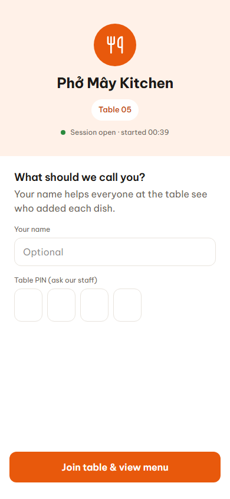
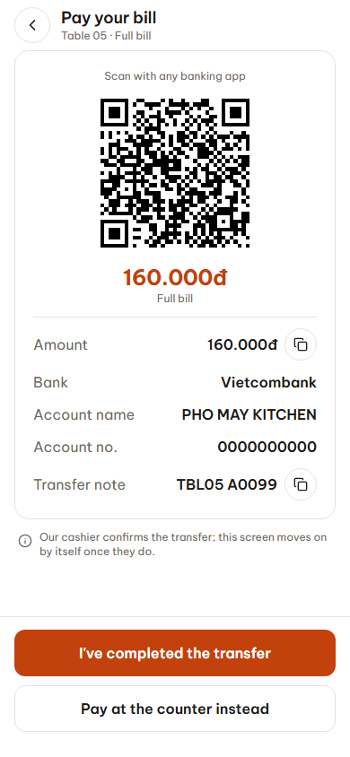
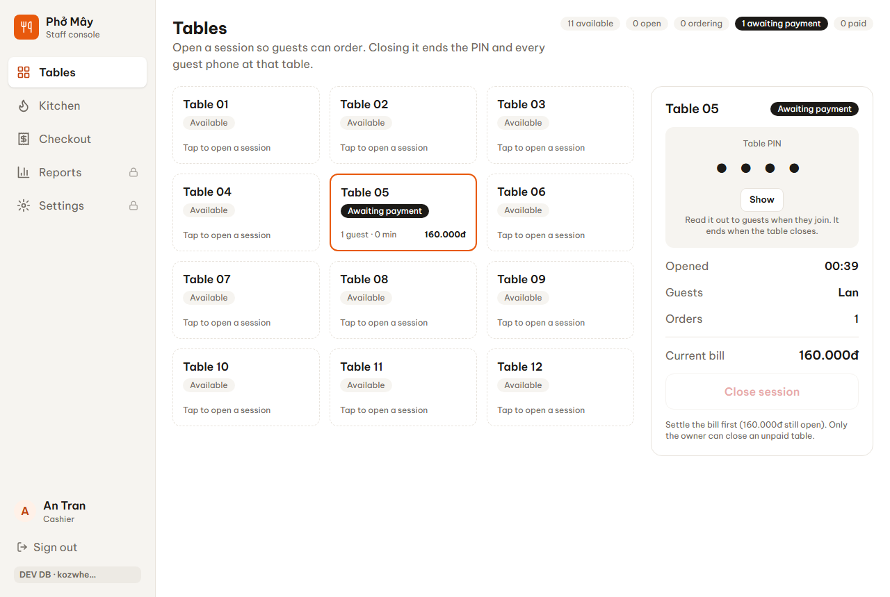
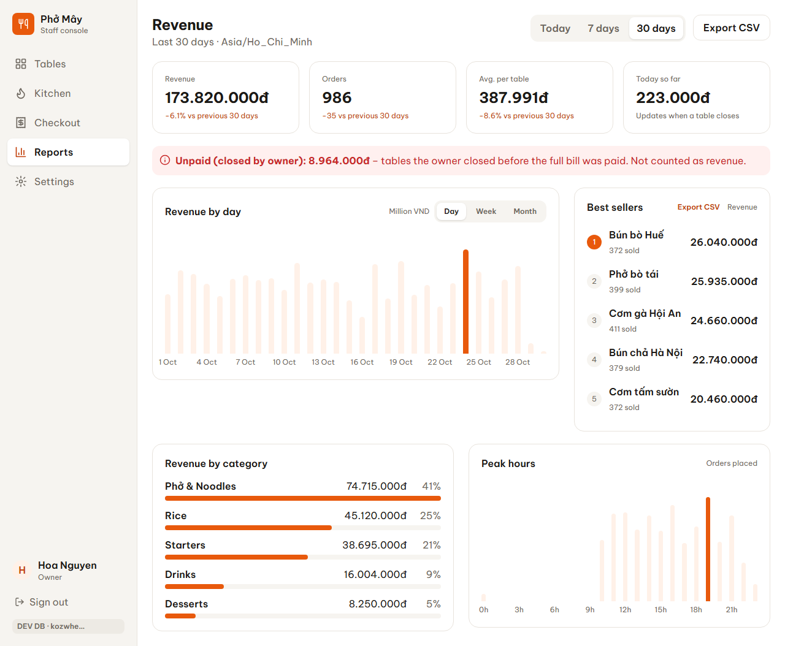
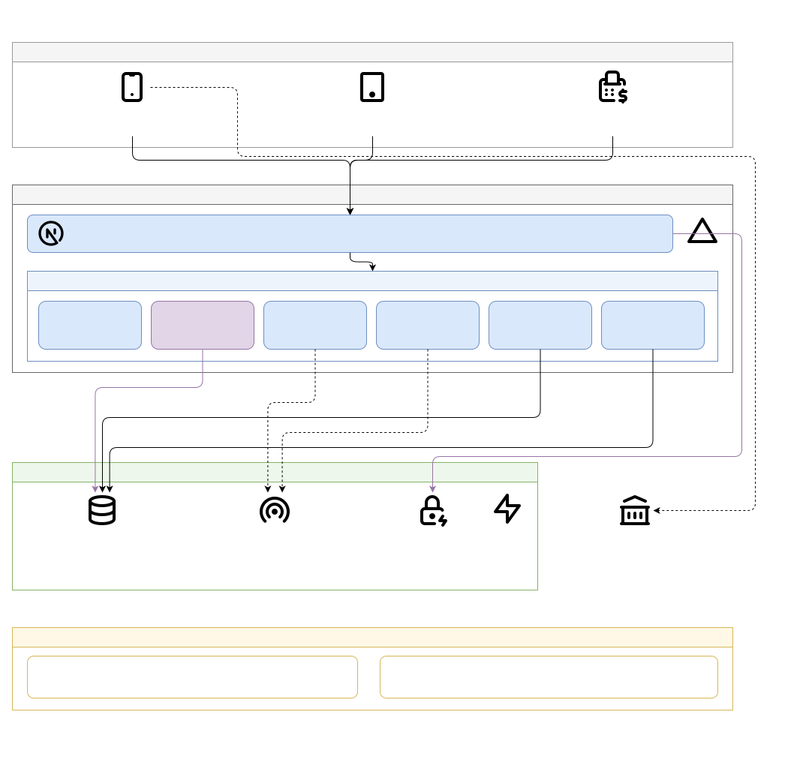

# TableTap – QR Ordering Starter Kit

Guests scan the QR on their table, order from their phone and pay with VietQR. The kitchen gets
orders in realtime; the owner closes bills and sees revenue.

Learn-by-building project · Jira: [LEARNING-94](https://lucenenguyen.atlassian.net/browse/LEARNING-94)

## Status: Phases 1–6 released

- **Production:** https://qr-ordering-starter-kit.vercel.app. Guests start from their table's QR
  code (`/t/<table>`); staff sign in at `/staff`.
- **All six phases are live** (released 2026-10-29):
  1. table menu;
  2. cart and orders;
  3. realtime kitchen;
  4. shared cart;
  5. table PIN, VietQR and checkout;
  6. revenue reports.
- **What was learned, phase by phase:** [`docs/lessons/`](docs/lessons/). Acceptance criteria and their
  evidence: [`docs/roadmap.md`](docs/roadmap.md). Unscheduled work: "Later" in the roadmap.

## Screens

Pictures of the app itself (dev database, demo bank account, PIN hidden).

<table>
<tr>
<td align="center" valign="top"><br><b>00</b> Join with the table PIN</td>
<td align="center" valign="top"><br><b>05</b> Pay with VietQR</td>
<td align="center" valign="top"><br><b>S1</b> Tables (staff)</td>
</tr>
<tr>
<td colspan="3" align="center"><br><b>O2</b> Revenue reports (owner)</td>
</tr>
</table>

The design prototype came first and differs in places (see its notes):
- **[Design prototype gallery](docs/prototype/README.md#screen-gallery)**: all 23 designed screens.
- **[Try the clickable prototype](https://qr-ordering-starter-kit.vercel.app/prototype/)**: guest app and
  staff console in one page, no sign-in, nothing saved.

To retake the app pictures (dev only): `E2E_SCREENS=1 npx playwright test app-screens`.

## Architecture



Flows step by step (join and order, VietQR checkout, closing a table and reports) are in
[`docs/architecture.md`](docs/architecture.md#sequence-diagrams).

## Quick start

```bash
npm install
cp .env.example .env.local   # fill in Supabase keys when Phase 1 needs them
npm run dev                  # http://localhost:3000
```

Requires Node.js 22.18 or newer (or 23.6+): `npm test` runs the TypeScript unit tests directly with `node --test`, which needs built-in type stripping.

## Docs

| | |
|---|---|
| `CLAUDE.md` | How to work in this repo (for people and AI agents) |
| `docs/roadmap.md` | Phases 1–6, scope and acceptance criteria |
| `docs/architecture.md` | System design, flows, trust boundaries (+ `architecture.drawio`) |
| `docs/data-model.md` | Supabase schema and RLS, per phase |
| `docs/runbooks/` | Production release steps (Phases 5 and 6) |
| `docs/prototype/` | Clickable UI prototype (`tabletap-prototype.html`, also at `/prototype`) and the screen gallery |
| `docs/screens/app/` | Pictures of the real app (used above). Retake them on dev with `E2E_SCREENS=1 npx playwright test app-screens` |
| `docs/decisions/` | Architecture decision records |
| `docs/lessons/` | Lessons learned per phase |

## Stack

Next.js (App Router) · TypeScript · Tailwind CSS v4 · Supabase (Postgres, Realtime, Auth) ·
Vercel · VietQR
