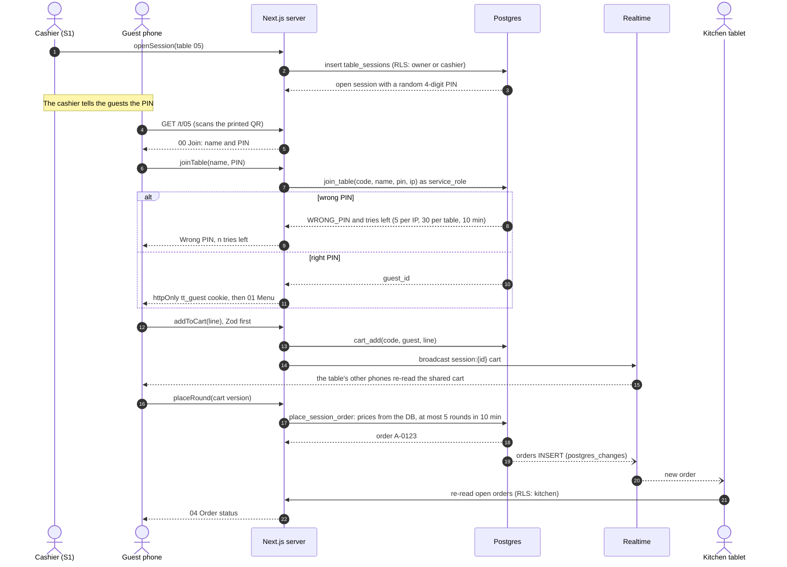
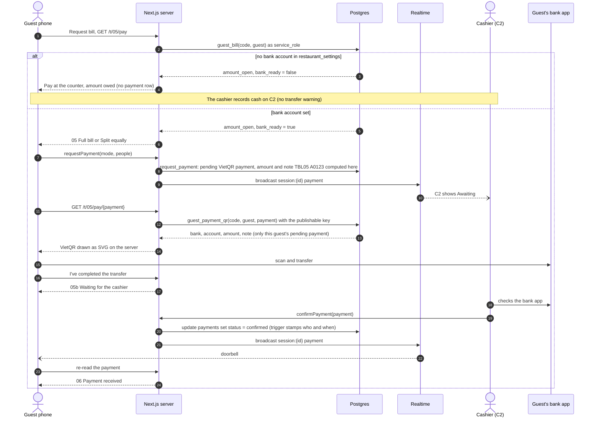
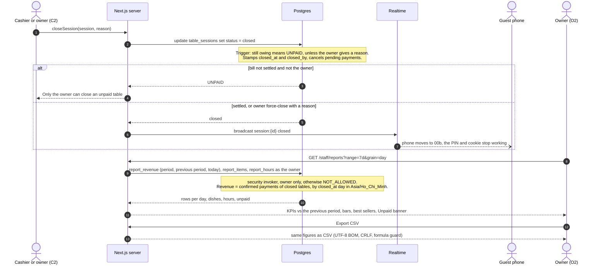

# Architecture

The source is `docs/architecture.drawio` (draw.io desktop or https://app.diagrams.net). After editing it, run
`node scripts/export-architecture.mjs` to regenerate `architecture.svg`.

## Sequence diagrams

**(a) Guest joins with the PIN, orders, and the kitchen sees it**

**(b) Request bill: VietQR, the cashier confirms, the guest sees "Paid"**

**(c) Close the table, then the owner sees it in O2**

## Request flows

**Guest orders (Phases 1–2, 4–5)**
1. Staff open the table's session on S1; the database gives it a 4-digit PIN (ADR 0003).
2. Guest scans `https://<app>/t/05` (the printed QR never changes) and joins with name + PIN.
   `join_table` checks the PIN and the wrong-PIN limits; the server sets the httpOnly `tt_guest`
   cookie (the guest's id – the only guest credential).
3. Cart changes and "Place order" are Server Actions: Zod, then the guest's open session from the
   cookie, then a service_role function that prices from the DB, rate-limits rounds and writes
   in one transaction. A broadcast on `session:<id>` makes the table's other phones re-read.
4. The new order reaches the kitchen through Realtime.

**Kitchen (Phase 3)**
- Client Component subscribes to `orders` changes; on reconnect it refetches open orders to
  resync anything missed. Status buttons call Server Actions (`advanceOrder`).

**Checkout (Phase 5)**
1. Guest taps Request bill → 05: full bill or an equal share. `request_payment` creates a pending
   payment; the database computes the amount and the transfer note `TBL{table} {first order}`.
2. The QR is drawn on the server from `guest_payment_qr` (publishable key; only this guest's pending
   payment in an open session) with the bank account from `restaurant_settings`. No account → "Pay at
   the counter".
3. The cashier sees the request live on C2 (`postgres_changes`), checks the bank app and presses
   Confirm received – or records cash, which withdraws awaiting requests after a confirmation dialog.
   Each change broadcasts `payment` on `session:<id>`; the guest's phone moves to 06 by itself.
4. Close table once settled (the owner may force-close with a reason). Closing ends the PIN and every
   guest cookie of the session, so a photographed QR cannot order any more.

**Reports (Phase 6, ADR 0004)**
1. O2 (`/staff/reports`, owner) calls `report_revenue` (current period, previous period, today),
   `report_items` and `report_hours` in parallel with the staff member's session.
   - The functions run as the caller and refuse anyone but the owner.
   - Other roles get O2b.
2. Revenue = confirmed payments of tables closed in the period, grouped by closing day, week or
   month in `Asia/Ho_Chi_Minh`. The page uses the same zone to decide "today".
3. "Export CSV" (`/staff/reports/export`, route handler, owner only) returns the same figures:
   UTF-8 with BOM, CRLF, and formula injection blocked.
4. No Realtime: the owner reloads or switches the period. Figures only change when a table closes.

## Trust boundaries

| Actor | Auth | Can |
|---|---|---|
| Guest | none; `tt_guest` cookie after joining with the session PIN | read menu; write cart/orders and ask to pay for **their open session only** (via Server Actions) |
| Kitchen | Supabase Auth, role `kitchen` | read open orders; advance status; mark sold out |
| Cashier | role `cashier` | tables, sessions, checkout, payments, menu availability |
| Owner | role `owner` | everything, incl. reports and settings |

Guest writes never use the anon key directly against tables; they go through Server Actions
that call service_role functions **after** checking the guest cookie. The one guest read with the
publishable key is `guest_payment_qr`, which checks the guest and payment itself.
Deployments: Production uses the prod Supabase project, Preview/Development the dev project; a
Preview that points at prod shows a red warning and refuses every write (`src/lib/db-target.ts`).

## Cost

Vercel Hobby + Supabase Free cover a few small restaurants. The only fixed cost is a domain
(~300.000đ/year). VietQR codes are generated from the open NAPAS/VietQR format, no fee.
