# UI / UX prototype

> [!NOTE]
> **Design reference, made before ADR 0003 and ADR 0004. The app differs:**
> - PIN join instead of rotating QR tokens;
> - Orders / Avg. per table in O2;
> - no O1 menu editor yet.
>
> Screens that differ are marked **≠ app** below. Pictures of the real app:
> [`docs/screens/app/`](../screens/app/).

`tabletap-prototype.html` is the UI reference. Open it in a browser (double-click). It has a
**Guest app** (390 px phone) and a **Staff console** (desktop/tablet) sharing one in-memory
state, so the end-to-end flow can be clicked through. Data resets on reload.

Also available as a hosted Claude artifact (private to the owner):
https://claude.ai/artifact/56pQByAEUJpVFkRfERcrag
Figma (secondary, may lag behind the prototype): https://www.figma.com/design/R0P31cqIX3WMJx0ypnVkqj

## Try it

- **Hosted with the app:** https://qr-ordering-starter-kit.vercel.app/prototype/ (after this change is
  deployed; `public/prototype/index.html`). It doesn't sign in or touch any data: everything lives in
  the page and resets on reload.
- **Locally:** open `tabletap-prototype.html` in a browser, or `npm run dev` → http://localhost:3000/prototype.

`public/prototype/index.html` is a copy of `tabletap-prototype.html`. After changing the prototype,
run `npm run prototype:sync`. `npm test` fails while the two differ.

## Screen gallery

Every screen of the prototype, by its code. Phases are LEARNING-95 (1) … LEARNING-100 (6). Screens marked
**≠ app** look different in the built app; the reason is under the picture.

To regenerate the pictures: `node scripts/capture-prototype.mjs`.

### Guest app (390 px phone)

<table>
<tr><td align="center" valign="top" width="25%">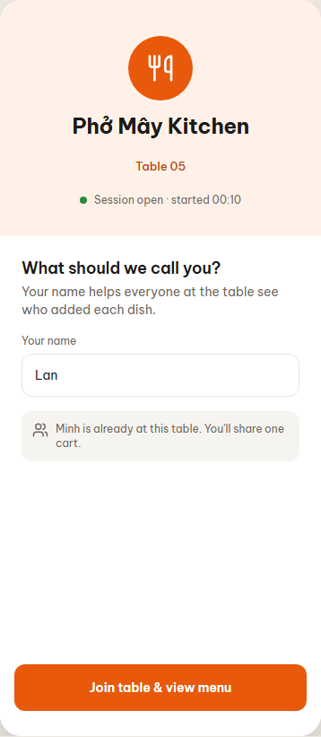 <b>00</b> Join table (name, PIN) Phase 1, 4, 5 · <b>≠ app:</b> app also asks for the table PIN</td><td align="center" valign="top" width="25%">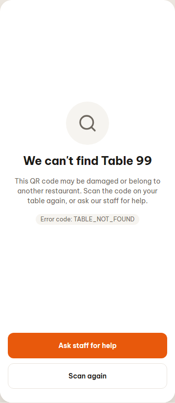 <b>00a</b> Table not found Phase 1</td><td align="center" valign="top" width="25%">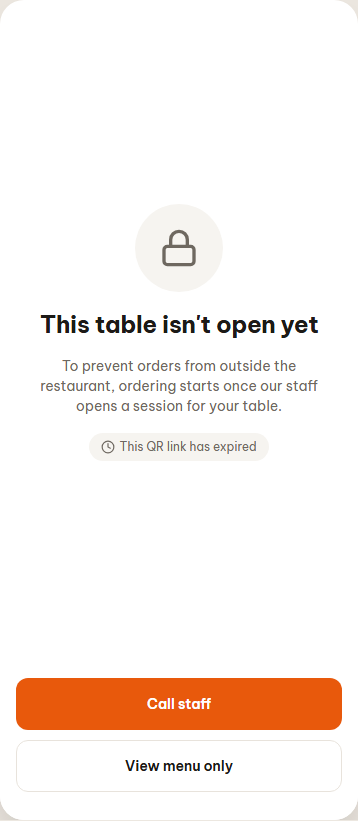 <b>00b</b> Session not open Phase 5 · <b>≠ app:</b> app: "This table isn't open yet", no expiring QR link</td><td align="center" valign="top" width="25%">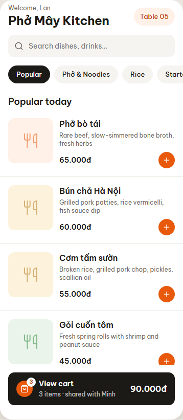 <b>01</b> Menu Phase 1</td></tr>
<tr><td align="center" valign="top" width="25%">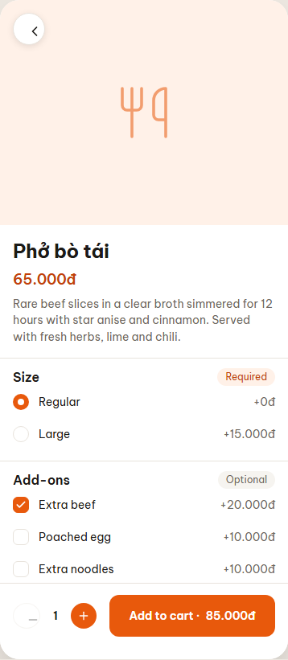 <b>02</b> Item detail Phase 2</td><td align="center" valign="top" width="25%">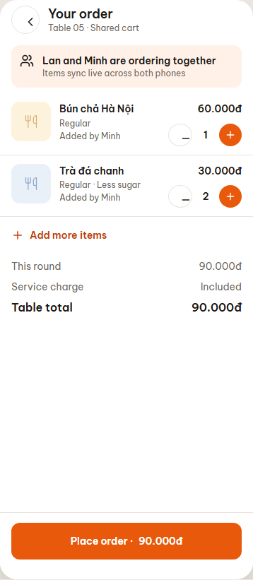 <b>03</b> Shared cart Phase 2, 4</td><td align="center" valign="top" width="25%">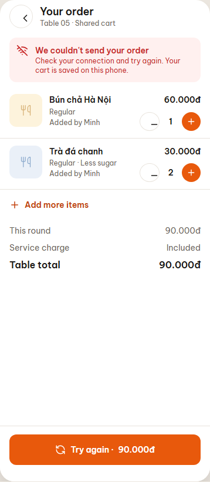 <b>03b</b> Order failed – retry Phase 2</td><td align="center" valign="top" width="25%">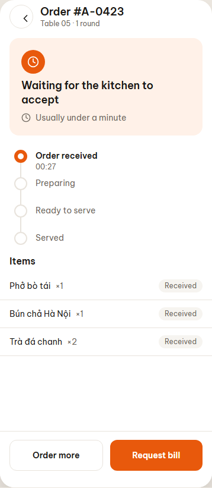 <b>04</b> Order status Phase 2, 3</td></tr>
<tr><td align="center" valign="top" width="25%">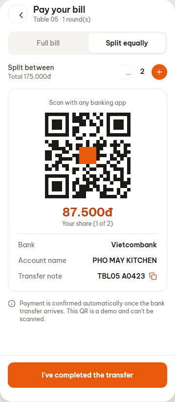 <b>05</b> Pay with VietQR (full / split) Phase 5 · <b>≠ app:</b> app: the cashier confirms the transfer, not automatic</td><td align="center" valign="top" width="25%">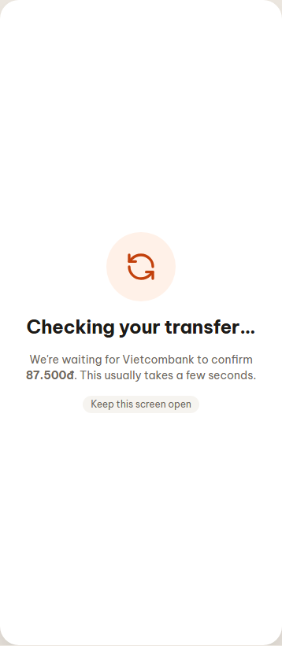 <b>05b</b> Payment pending Phase 5</td><td align="center" valign="top" width="25%">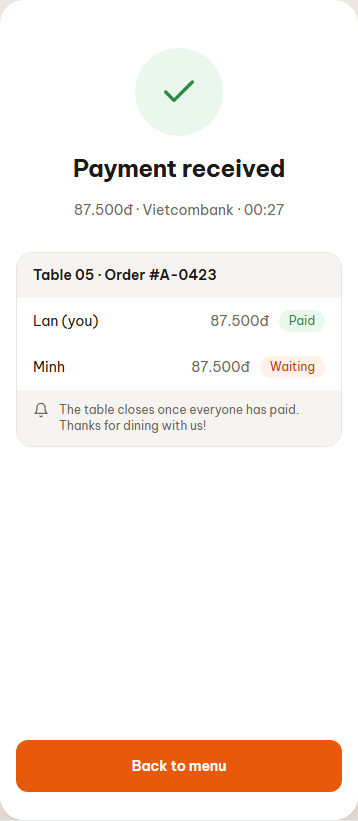 <b>06</b> Payment received Phase 5</td></tr>
</table>

### Staff console (1280 px)

<table>
<tr><td align="center" valign="top" width="50%">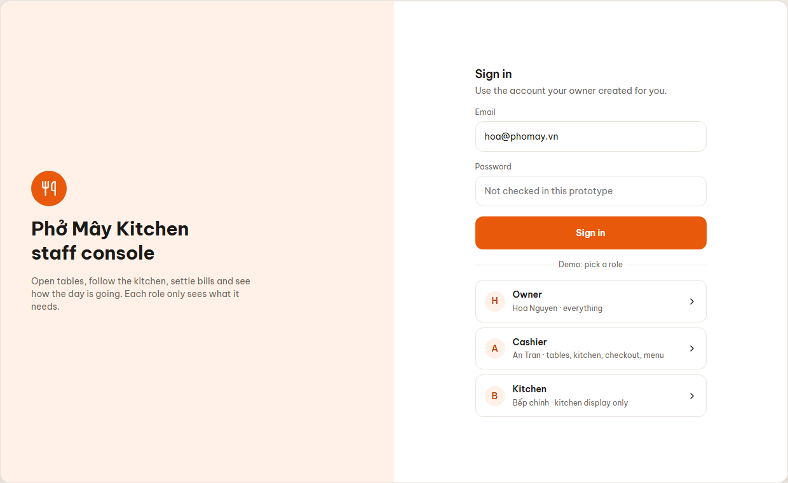 <b>S0</b> Staff sign in Phase 3, 5</td><td align="center" valign="top" width="50%">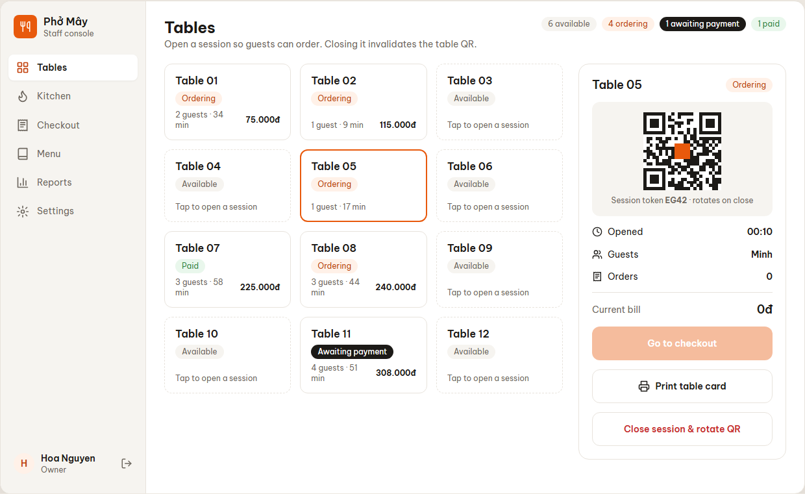 <b>S1</b> Tables Phase 5 · <b>≠ app:</b> app: 4-digit PIN instead of a rotating session token</td></tr>
<tr><td align="center" valign="top" width="50%">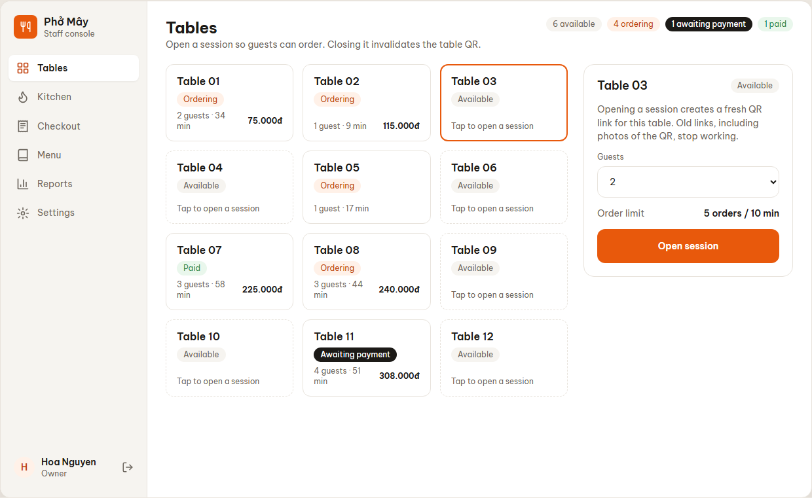 <b>S1b</b> Open session (PIN) Phase 5 · <b>≠ app:</b> app: PIN, the printed QR never changes</td><td align="center" valign="top" width="50%">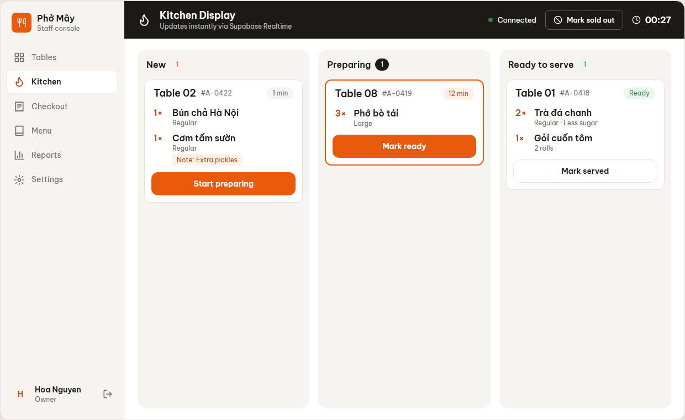 <b>K1</b> Kitchen display Phase 3</td></tr>
<tr><td align="center" valign="top" width="50%">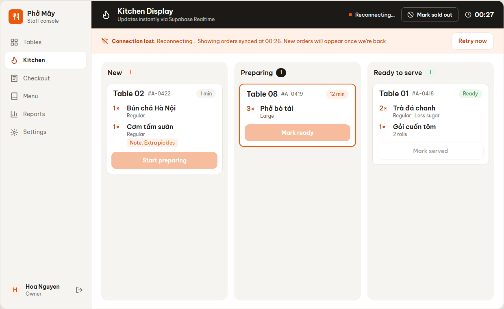 <b>K1b</b> Kitchen offline / resync Phase 3</td><td align="center" valign="top" width="50%">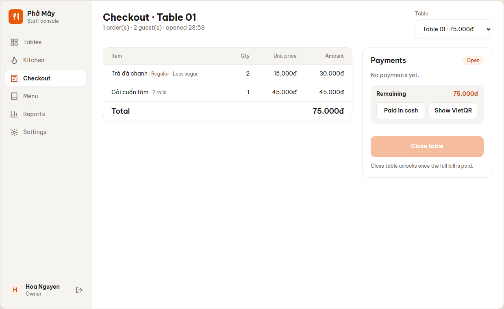 <b>C2</b> Checkout Phase 5 · <b>≠ app:</b> no "Show VietQR" yet; the table QR doesn't rotate</td></tr>
<tr><td align="center" valign="top" width="50%">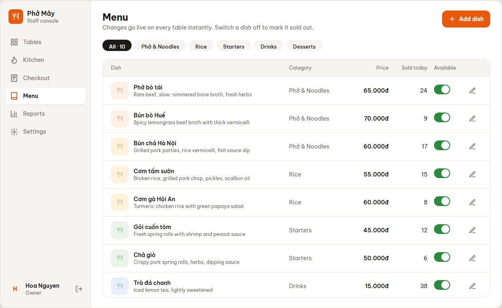 <b>O1</b> Menu management Phase 1, 3 (backlog) · <b>≠ app:</b> not built yet (backlog)</td><td align="center" valign="top" width="50%">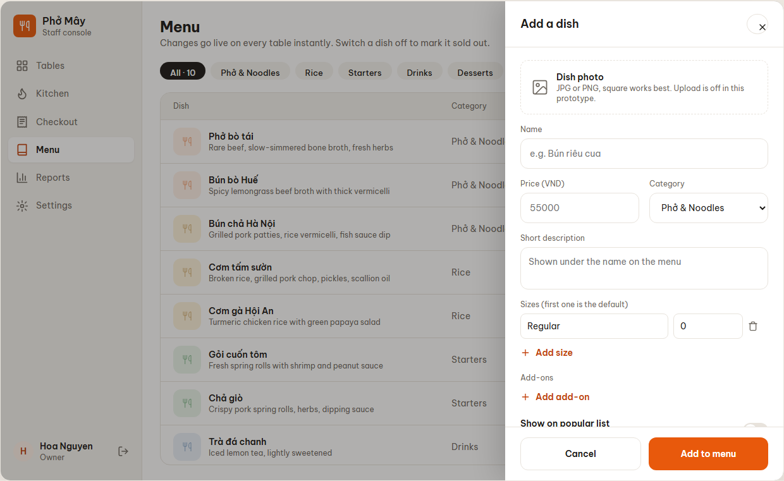 <b>O1b</b> Add / edit dish Phase 1, 3 (backlog) · <b>≠ app:</b> not built yet (backlog)</td></tr>
<tr><td align="center" valign="top" width="50%">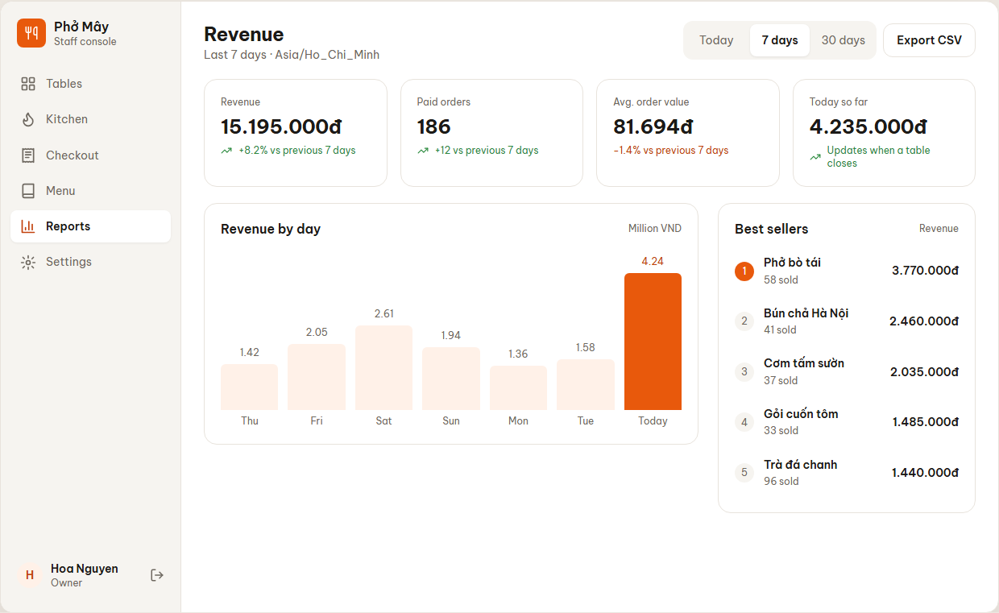 <b>O2</b> Revenue reports Phase 6 · <b>≠ app:</b> app: "Orders" and "Avg. per table" (ADR 0004)</td><td align="center" valign="top" width="50%">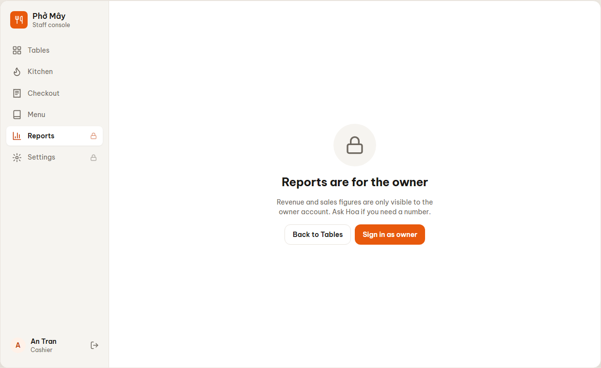 <b>O2b</b> Reports · cashier (no access) Phase 6</td></tr>
<tr><td align="center" valign="top" width="50%">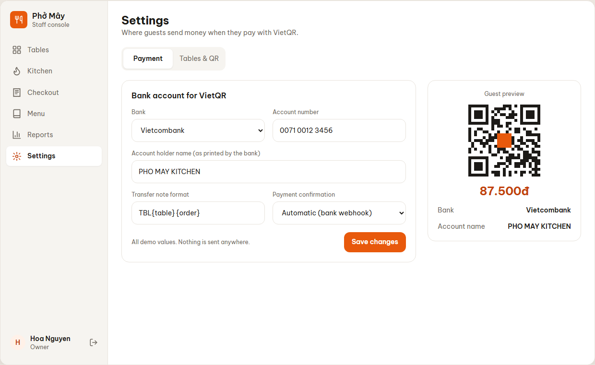 <b>O3</b> Settings · VietQR bank account Phase 5 · <b>≠ app:</b> app: manual confirmation only, no bank webhook</td><td align="center" valign="top" width="50%">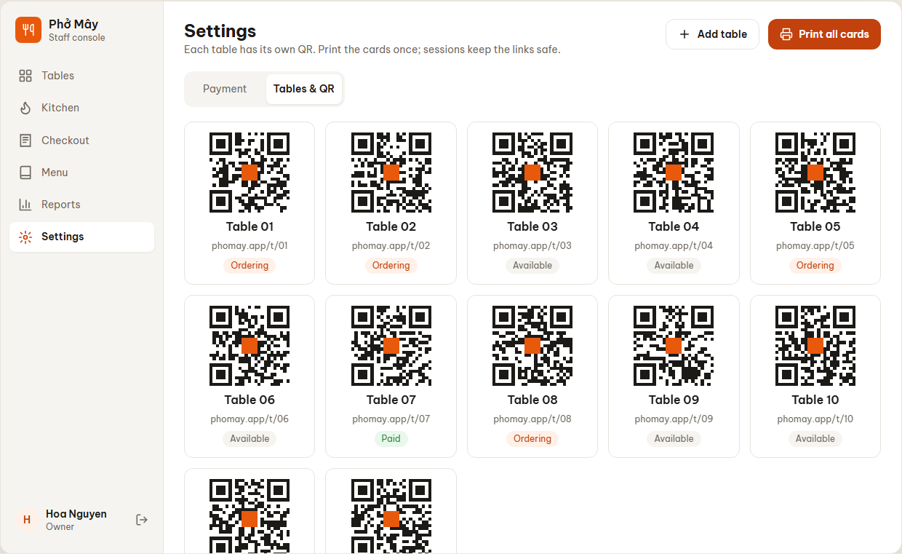 <b>O4</b> Settings · Tables & QR cards Phase 1</td></tr>
</table>

## Design tokens

Same values as `src/app/globals.css` (`@theme`). Font: Be Vietnam Pro 400/500/600/700.
Brand `#E8590C`, brand-strong `#C2410C`, text `#1C1A17`, muted `#6E6860`, surface `#F6F4F0`,
surface-brand `#FFF1E8`, border `#E8E3DC`, success `#2B8A3E`.
